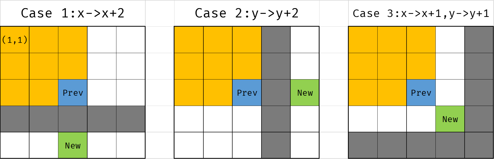

# T1
> 数轴上有 $n$ 个点，给定一个整数 $k$，你可以将数轴划分成 $(-\infty,s], (s,s+k],(s+k,s+2k]\dots(s \in [0,k))$，最小化有点的区间数。
>
> $n\le2\times10^5$

考虑一个最终情况，如果说没有任何一个点在区间的边界上，那么将区间平移使得有一个点顶到了端点一定不劣。因此现在只需要枚举是在哪个端点。

由于 $s$ 只在一个周期内移动，每个点只会变化一个区间（其实 $s$ 移动再多了也没用），因此按照 $a_i \mod k$ 排序以后扫一遍，动态维护每个区间有几个点就可以了。

# T2
> 一个斗地主房间，$n$ 个人同时开始匹配，匹配规则是三个人的积分的极差不能超过当前的秒数 $s$，从字典序最小的三个开始匹配，问最终匹配到的顺序。
>
> $n \le 2\times10^5$

---

下面是我的做法。

坑人啊，过于难写了，导致最后没写完还没时间打别的暴力了。

考虑由于是按照极差为第一关键字排序，最初的匹配一定是在值域上相邻的一些点。如果积分两两不同的话，可以把所有排序之后的 $(i,i+1,i+2)$ 对都扔到一个 `set` 里，然后用一个链表维护现在还剩啥，每次找出最小的，删掉这个对和所有影响到的对，然后再把值域合并，加入新产生的对。

但是现在积分是有重合的，首先如果有 $\ge 3$ 个相等的人那么肯定是在最开始的时候就羊了个羊了，所以每种积分最多只有 $2$ 个。分类讨论几种情况即可。

---

实际上不用这么麻烦，可以发现其实直接把前后一个大小为 $7$ 的窗口拉出来，但是本质相同，还是不很好写。

# T3
> 你有壁垒计妥，初始有 $k$ 点防，第一回合抽两张牌，后面每回合抽一张牌，每张牌可能是防 $a_i$ 也可能是巩固，都是 $1$ 费且必须打出一张，现在已知怪每回合打多少以及抽牌堆长什么样（总共有 $n + 1$ 张牌，打 $n$ 回合，打完就下播），问能无伤防多少回合
>
> $n \le 2\times 10^5$

对于 $n^2$ 的部分分，显然可以写个 DP，记经过了 $i$ 个回合以后，现在剩下的是第 $j$ 张牌时最大能有多少防。显然如果防大于 $2 \times 10^{14}$ 的时候就可以直接无伤通关了，所以不用担心爆。

然后考虑优化。保留巩固的时候，只需要记录最大的格挡是多少，而保留防牌的时候要记录上面那个 DP 的两个状态。发现一个方案如果保留牌小并且总的防（已有的和保留的加起来）也小的话，这个位置就没有保留的必要了，也就是说处理出来支配对应该是保留牌递增，剩余格挡递减，且求和单增的序列。

在转移的时候，如果保留的和新的都是防，那么显然先把大的打了是不劣的。因此，对于保留牌大于当前牌的，可以直接处理出来保留新牌，打出旧牌的最优值并且统一转移到保留当前牌的方案，同时这种转移对于原来的牌是巩固同样有效。否则只需要标记一个全局平移即可，同时弹出已经变成负数的状态。

如果新牌是巩固，那么如果保留巩固就是全局平移，而如果打出巩固的话就是全局乘 $2$ 并保留。

GPT 给的复杂度分析方式是，一个数会出入栈一次，然后全局加法不影响差值，全局乘 $2$ 会直接让差值翻倍，翻倍 $O(\log)$ 次以后由于保留卡不翻倍所以差值必定会大于保留牌，因而这些状态必然被支配，所以复杂度是 $O(n \log V)$。

然后这个还可以做到线性，感觉好像区别不是很大，主要的难点感觉是转移很诡异。

# T4
> 一个方阵，初始可以点亮一些位置，对于一个格子如果他附近有两个格子被点亮了他就会被点亮，并最小化初始点亮的方案数以及构造方案。初始时禁用一些行和列，这些位置无法点亮。
>
> $n \le 2 \times 10^5,0\le a, b \le n$

无解的情况比较明显，如果边上被禁用了或者有连着两行或者两列被禁用了就肯定无解，因为这种情况下这一行/列最多只能有一个位置相邻。

考虑如何构造。方案长这个样子：

假如目前构造的东西已经能点亮 $[1,x] \times [1,y]$ 的所有位置，现在需要点亮更多的点。

依次判断下面的策略：
1. 如果 $x + 1$ 行被禁用了，那么直接跳到第 $x + 2$ 行。
2. 否则如果 $y + 1$ 行被禁用了，那么直接跳到第 $y + 2$ 行。
3. 都不是的话，如果两侧还有空地，两侧各加一格。
4. 否则向还能移动的方向移动一格

考虑操作次数，应该是 $\max\{\}$