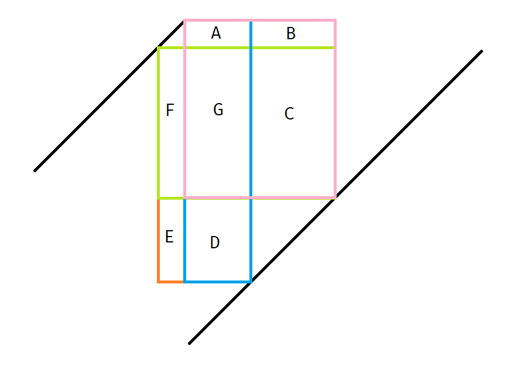

## A. [Rabbit, Rabbit, Rabbit](https://qoj.ac/problem/22852)
感性理解是好想的。但是证明看上去很诡异啊。

首先是无解的情况。一眼奇偶性，要求每只兔子的初始位置和最终位置的距离的奇偶性相同，那么分类讨论是奇数还是偶数，分别进行计算。然后就是肯定小的对应小的，大的对应大的最优（证明应该相对显然），那么就可以知道操作次数了，因此对于每个位置可以知道他分别向左向右多少次，而一次操作中往左往右的数量差的越多就越有利，而且这个有利的速度也是增大的，因此肯定是尽可能的多往右（或者往左）。

证明看上去非常猎奇。
## B. [Deque Bracket Optimization](https://qoj.ac/problem/22854)
好深刻的反悔贪心。

经典套路是用一个堆来维护。但是这个题有修改，考虑这个贪心的方式是要求两两为一组的，所以仅从前面和后面插入都相对容易，考虑在尾部加入的时候，只需要在原来的堆的基础上再加进去两个即可（注意每个串的最后一个是没放进去的，所以加入的时候应该加上原来的最后一个和新的前一个，然后把新加入的后一个看做新的末尾），在前面的话其实也类似，毕竟每次都是选择堆中的最大值，那么在前面加入两个以后，可以让所有位置中最小的一个剔除，因此再用一个小根堆维护所有选了的位置即可。

对于前后都要加的情况，直接计算会完全破坏奇偶性导致原来的堆完全失效。那么一个自然的想法应该是考虑维护一个平移以后的堆，具体来说，就是把头尾掐掉以后剩下的括号序列的权值最大值。那么这个堆就容易实现前后的操作了，因为每次相当于是把大序列作为掐头去尾的序列，然后把原来被掐掉的序列两端各进行一次增加操作。

## C. [Celester 2](https://atcoder.jp/contests/abc464/tasks/abc464_g)
证明凸函数的方法：感性理解、打表、后面忘了。

这题可以建费用流模型，所以同时可以证明反贪的正确性和函数的凸性。一个自然的想法是直接 DP，但是这样肯定没有任何前途（毕竟这个东西应该没什么优秀的性质），但是反过来是有的，算 $x$ 个 RS 需要进行几次操作。那这个看上去就很凸，因此可以闵和分治，双指针合并。

这个费用流建模也很牛啊。首先按照奇偶性分成两部分，源点连向所有奇数位置，所有偶数位置连向汇点。然后就是考虑 RS 结构，一个简单的想法是每个奇数点拆成 R 和 S 两个点，让每个偶数点前面都连 R 和 S，然后把每个点的 R 连向下个的 S。但是很遗憾这样算重了，因为一个点可以同时是 R 和 S，然后就炸掉了。解决方法是，要求流量都是从奇数点连向偶数点的，也就是偶数点只进不出，这样一来由于偶数点向汇点的流量限制，保证了每个偶数点只会被选一次，奇数同理。
## D. [Children Yearn for the Evil Kindergarten](https://atcoder.jp/contests/abc458/tasks/abc458_g)
很有意思啊，感觉这种想法挺奇妙的。

首先如果能留下来 $k$ 个小孩，那么留下来 $k - 1$ 个肯定也是可以的。所以可以尝试二分。发现由于小孩都是相同的，如果要保留 $k$ 个，那么最开始就只需要保留 $k$ 个即可。然后就是如何让小孩逃跑，此时一个简单的想法是尽可能的跑，但是会发现一个问题：如果让一个孩子先留着，等到以后某个更便宜的时间再逃跑就相当于是赚了。所以可以考虑反悔贪心，先尽可能地跑，然后用一个堆维护每个孩子拽回来的价值，然后如果在某一天发现堆顶的小孩挪到今天会更优秀的话，就把他拽回来重跑。
## E. [周长](https://codeforces.com/gym/106440/problem/E)
可以证明这玩意有决策单调性。具体来说，当左上角固定在 $x + y = k$ 时，右端点的坐标一定会递增。因此可以直接跑决策单调性。

问题是如何证明决策单调性。挺有意思：

已知 $F + G + C \ge F + G + E + D$，则 $C \ge E + D$。

比较 $A + G + D$ 与 $A + B + C + G$，也就是比较 $D$ 与 $B + C$。由于 $B + C \ge B + E + D \ge D$，故 $D \le B + C$，即决策单调性成立。

感觉挺神奇的。
## F. [Investors](https://qoj.ac/problem/5507)
两个傻X思考了半天怎么把决策单调性优化到一个 $\log$。

发现一次加肯定是加到一整个后缀上，否则扩展到后缀一定不劣。进一步地，一次肯定加一个巨大的数，这样前后就不再有任何逆序对存在。因此这个问题就是将区间划分成 $k$ 段，每段的价值是逆序对。

然后问题来了，直接跑类似莫队的东西的话，复杂度是两个 $\log$ 的，怎么优化呢？事实上正常来说这题的板子之所以是两个 $\log$，是因为 $n$ 很大，而这个题 $n$ 只有 $6000$，所以可以直接把区间逆序对全都预处理出来。😰😰😰

听说可以不带 $\log$，好牛，不会。
## G. [Nawiasowe podziały [B]](https://qoj.ac/problem/5246)

## H. [Graph Weighting](https://atcoder.jp/contests/utpc2023/tasks/utpc2023_g)

## I. [True or False Test](https://qoj.ac/problem/10966)

## J. [一棵树](https://qoj.ac/problem/7961)
