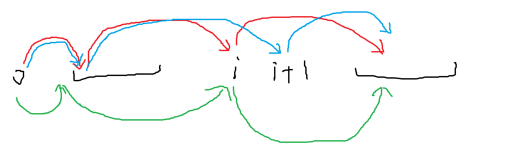
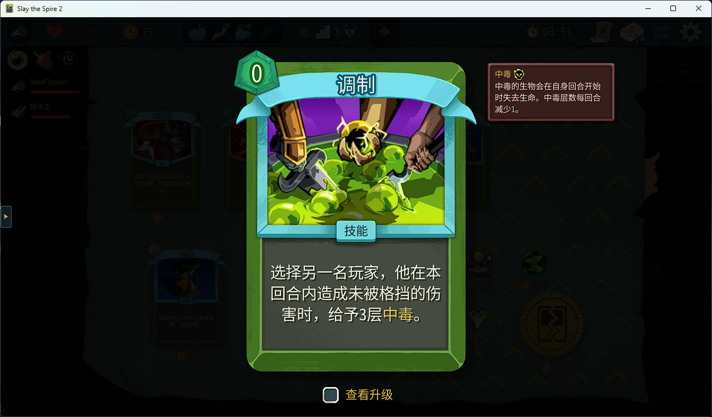
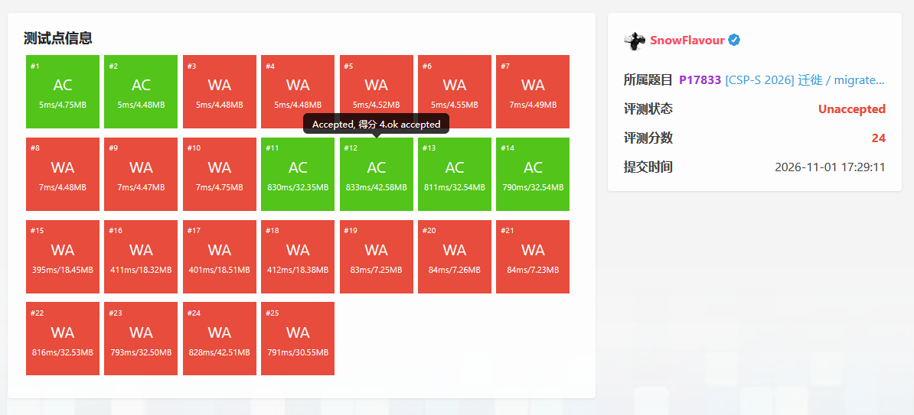
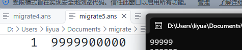

## Day -6
骑了一整天车。白天一直在随机游走，一路骑到了经十东路南边。晚上与邢村立交桥大战三百回合，被卡在里面找不到出来的路，然后终于出来了，骑了一会发现走反了，于是又大战了三百回合，过济南东高速收费口的时候有一段很诡异的路，完全没有路灯，正好我车灯快没电了，摸黑骑了一会差点给我吓死，最后还是把灯打开了。这是我第二次知道闵子骞路和燕子山路是连着的。
## Day -5

## Day -4
> 最后一场模拟赛了，打好点行不行啊。
> 
> 不行。

和 T2 进行了一番激烈的斗争，最后发现根本调不出来获得 0 的高分。由于下午第一节是体育所以车停到教室一侧了所以晚上没法去占排球场了，过去一看只有最烂的六场，然后 glx 研究一番以后得出结论二场根本没人用，于是莫名其妙地获得了二场。

## Day -2
lcn 负责给下面几级同学搬模拟赛。让我们祝贺他写挂了 T1 的数据范围，并在【】的要求下删掉了捆绑导致最后一个题不可以总司令获得了 $63$ 分的高分（后续：又绑回来了）

复习串串的时候突然有一种自己在背政治的感觉。

## Day -1
【】认为 lcn 的上一场模拟赛过于困难了（其实是 ****** 的全是 T1T2 版本），于是搬了场 Div.2 上去。

已严肃完成溜出去吃疯 4 被逮捕大学习。

## Day 0
本来在家摆烂了，zgh 告诉我有体育课于是跑过去上，结果到那没有找到自己班，于是直接逃跑然后去找找事进行了谈话。

下午坐火车，车上阅读了小蓝本组合数学。

晚上开了一把猎宝，大哥为啥每次玩刀猎都打老头啊，幸好我是苦无袖箭开信刀恐怖终结技三精准钢铁风暴选手，（你玩不玩），然后矛盾给我发了个鸟居。

然后发现自己这个档观者玩太少了还有个打击木偶没解锁，于是开了把然后成功玩上了小循环，然后高高兴兴进了三楼发现怎么还是老头，于是紧急抓了第二张虎和一张停顿。但是太晚了于是没打老头直接睡了。

哦等会这天要试机来着，去的时候堵了会车，过去又上演了保留节目 C 座在哪，于是过去的时候几乎没人了，随便试了试，敲了个快读上去，结果没写引用调了半天，然后就下播了。

## Day 1
上午进行了科学探究：如何在海边打水漂。然后发现一个很好看的海螺，过去刚要捡来了个浪给我鞋弄湿了，恰好我还没有备用的袜子/ch

回去把老头打了，SL 了好几次，最后没时间打心脏了，吃了个麦当劳爽睡一个小时，起床过去发现又错过了合影。人生最大的遗憾：考了 4 年 CSP 有三年没能合影。

进考场先把快读和对拍的板子敲了，本来还想敲个熊大熊二镇宅的，后来想了想太耽误时间了，于是愣神了三分钟左右，成功在老师写完密码的前 8 个字符的时候自动补全了后面的密码。

开题先看了眼 T1，本来想顺着读一遍的，奈何这个 T1 貌似只需要一分钟就能写完，于是 14:36 过了大样例。然后读了半天 T2，经过 10 分钟左右的艰难阅读终于搞明白了地铁长什么样。最开始以为 $n$ 是地铁站，后来发现是地铁线，于是思考这个 $n$ 和 $d$ 的范围有啥用，然后发现原来可以直接暴力连边建一个只有地铁线的图。写完大概 15:20，一遍过了大样例。

此时过去不到 1h，于是开始大大方方冲 T3。感性理解了一下，觉得应该不会分很多叉，于是推了一下发现只能是相邻分叉，并且只有一个叉。那么剩下的应该就是两边选一条唯一的路径过来即可，那么自然是左右两边各找一个最远只能到这一对的区间，然后区间内的点可以贡献，区间的远端的边界还可以继续扩展，扩展应该可以用 DP。思考一会觉得可行，于是开写，大概 16:00 写完，小样例一遍过，然后第一个大样例就挂了。调出来几个错以后过掉了第一个大样例，然后发现第二个大样例不对。我看了一下后面几组小数据，发现了一个严重的问题：

红色和蓝色是预期的两条路，但是这里有可能存在一条绿色的路径。此时已经是 16:30，如果做法假了就可以跳了，但是思考了一下发现其实这个只需要讨论一下 $i$ 和 $i + 1$ 的左端点是否相同即可，然后就过了所有大样例。此时是 16:44。

还剩 2h，感觉可以随便冲 T4 正解了，然后冲了半个小时发现毫无进展，于是开始想暴力，如果是要求一个连通块的话应该是直接剥叶子就可以了，那么两个应该是枚举断掉一条边然后再剥叶子就行了。然后发现自己不会剥叶子，最开始随便钦定了个根，然后发现好像这样不对，然后思考了半天发现好像脑子欠费了只好写了个 `set`，然后获得了 40 分。此时已经是 18:05，应该没有时间去写别的暴力了，于是看了眼 A 性质就开写，然后等到回去一看发现自己把图的形态看错了，原地挂掉 10 分。

根据赛后拆解，就算是把图的性质看对了，现在也应该去写个 T2 或者 T3 的对拍的，毕竟赛后评价是 T2 等于没有大样例而 T3 的大样例可以放过一些完全是假的刻画，不过最后还是在 18:25 终于把这个错误的 A 性质调出来了，然后就没什么能干的了，检查了一下文件就跑路了。

出去一问发现好像 T3 有点个人差了，目前好像 sdfz 没有过的。到火车上先把心脏打了，然后本来想和 god_gold 塔 2 的，奈何这个塔 2 不知道为什么开开就闪退，最终只得作罢。

到济南东发现网约车叫不上，本着省钱就是王道的观念跑到地铁站，发现 3 号线大站快车上一班在 1 分钟之前刚刚开走，于是原地罚坐 20 分钟，坐到八涧堡打车回去的（此时 2 号线已经停了，理论上三号线应该只有大站快车了，但是反向的车由于是周华健演唱会所以甚至还是 5 分钟左右一班）。

## Day 2
在 00:00:30 终于到家。

上午打了会塔 2，一个毒猎一个刀猎，我玩的测试版，获得了调制：

然后我直接变成金牌辅助，抓了两张调制一张爆发，合着一下能给 12 毒，对方弄了个刀伤额外增加毒伤的效果，于是直接变成秒杀局。

下午重写代码，感觉 T1 和 T2 没什么重写的兴趣，于是直接开始写 T3，默写了一遍以后依旧被前两个卡了半天，过了第二个大样例，寻思着和之前写的应该一样了，交一发，心梗了：

然后回来一测，发现过不了第三个大样例，别吓我大哥。

然后发现是有个 +1 写错地方了，这下大样例全都过了，交上去过了。终于安全了（）

写了个 T4 的暴力，也确实得了该得的分，这下感觉比较稳当了。

睡了个很长时间的午觉，感觉自己应该是感冒了。

## Day 3

早上起来吃完早饭，感觉晚上该吃感冒药的。实在撑不住了，又回去睡了一会。

到机房以后把前两个题写了，应该没锅。