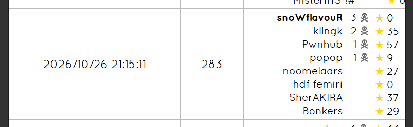

## Day -6
骑了一整天车。白天一直在随机游走，一路骑到了经十东路南边。晚上与邢村立交桥大战三百回合，被卡在里面找不到出来的路，然后终于出来了，骑了一会发现走反了，于是又大战了三百回合，过济南东高速收费口的时候有一段很诡异的路，完全没有路灯，正好我车灯快没电了，摸黑骑了一会差点给我吓死，最后还是把灯打开了。
## Day -5

## Day -4
> 最后一场模拟赛了，打好点行不行啊。
> 
> 不行。

和 T2 进行了一番激烈的斗争，最后发现根本调不出来获得 0 的高分。由于下午第一节是体育所以车停到教室一侧了所以晚上没法去占排球场了，过去一看只有最烂的六场，然后 glx 研究一番以后得出结论二场根本没人用，于是莫名其妙地获得了二场。

## Day -2
lcn 负责给下面几级同学搬模拟赛。让我们祝贺他写挂了 T1 的数据范围，并在【】的要求下删掉了捆绑导致最后一个题不可以总司令获得了 $63$ 分的高分（后续：又绑回来了）

复习串串的时候突然有一种自己在背政治的感觉。

## Day -1
【】认为 lcn 的上一场模拟赛过于困难了（其实是 ****** 的全是 T1T2 版本），于是搬了场 Div.2 上去。

已严肃完成溜出去吃疯 4 被逮捕大学习。

## Day 0
本来在家摆烂了，zgh 告诉我有体育课于是跑过去上，结果到那没有找到自己班，于是直接逃跑然后去找找事进行了谈话。

下午坐火车，车上阅读了小蓝本组合数学。

晚上开了一把猎宝，大哥为啥每次玩刀猎都打老头啊，幸好我是苦无袖箭开信刀恐怖终结技三精准钢铁风暴选手，（你玩不玩），然后矛盾给我发了个鸟居。

然后发现自己这个档观者玩太少了还有个打击木偶没解锁，于是开了把然后成功玩上了小循环，然后高高兴兴进了三楼发现怎么还是老头，于是紧急抓了第二张虎和一张停顿。但是太晚了于是没打老头直接睡了。

哦等会这天要试机来着，去的时候堵了会车，过去又上演了保留节目 C 座在哪，于是过去的时候几乎没人了，随便试了试就走了。

## Day 1
上午进行了科学探究：如何在海边打水漂。然后发现一个很好看的海螺，过去刚要捡来了个浪给我鞋弄湿了，恰好我还没有备用的袜子/ch

回去把老头打了，SL 了好几次，最后没时间打心脏了，吃了个麦当劳爽睡一个小时，起床过去发现又错过了合影。人生最大的遗憾：考了 4 年 CSP 有三年没能合影。

进考场先把快读和对拍的板子敲了，开始