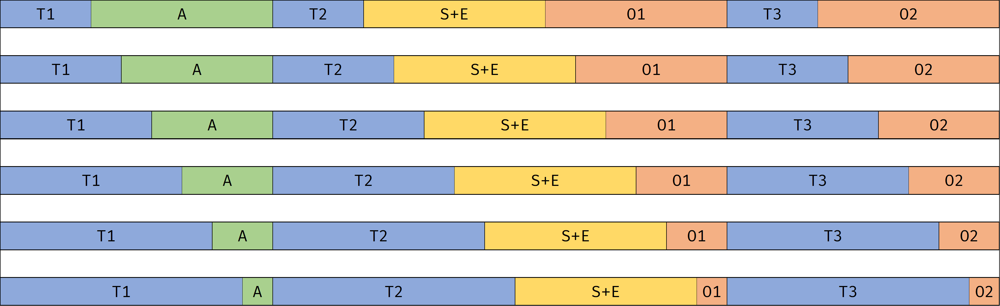
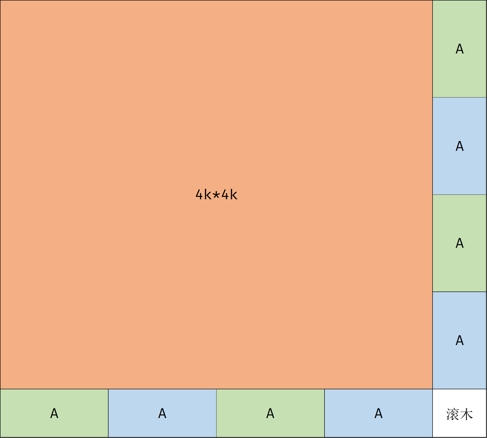
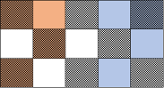
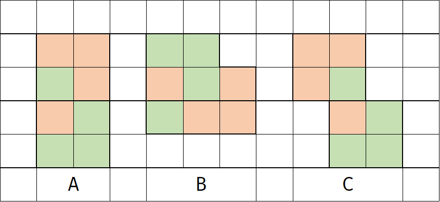
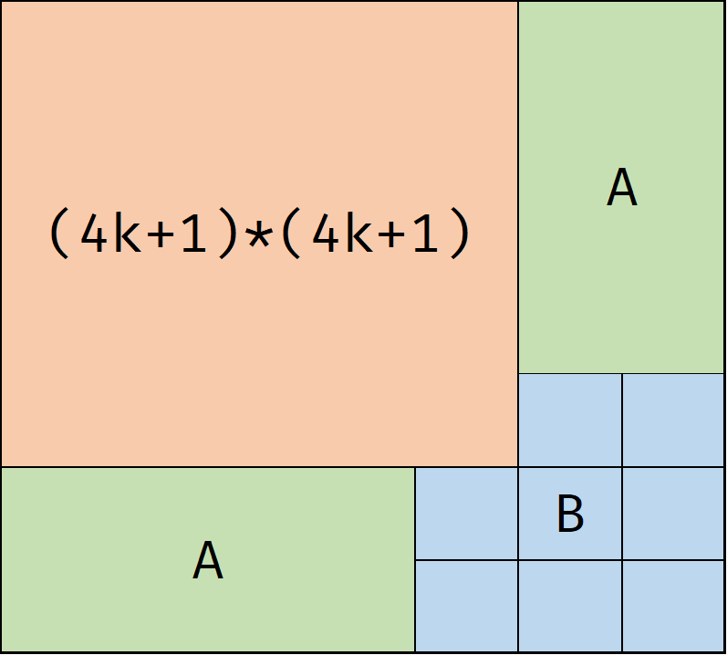
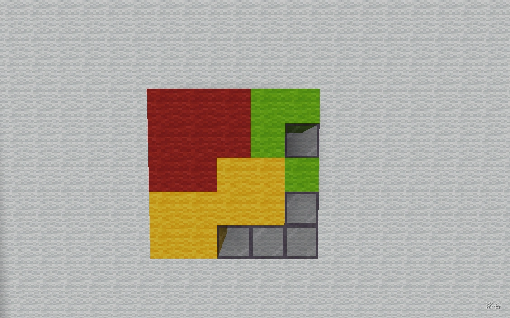
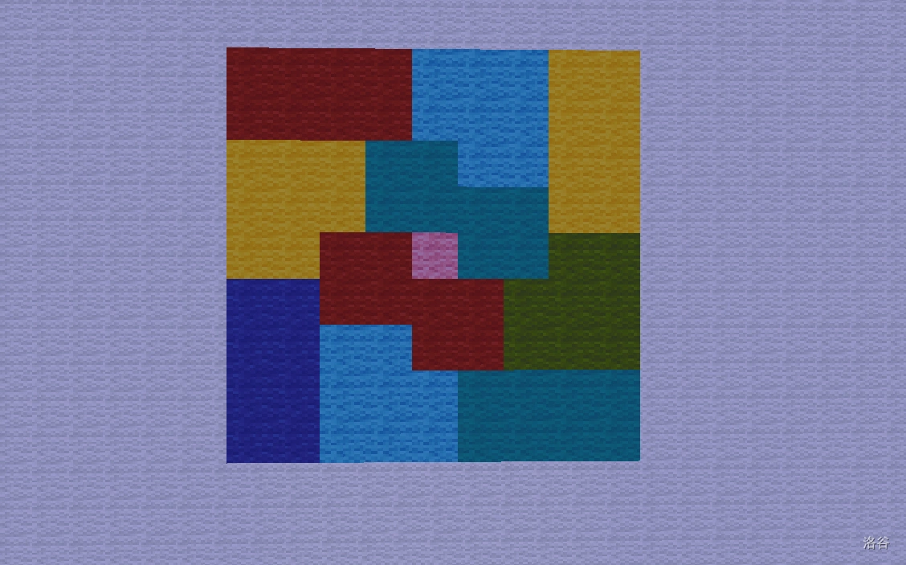
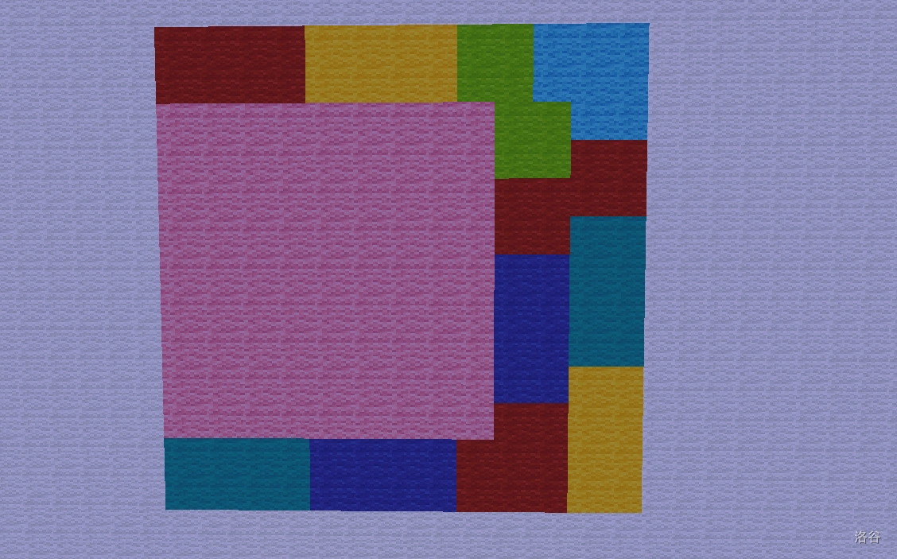
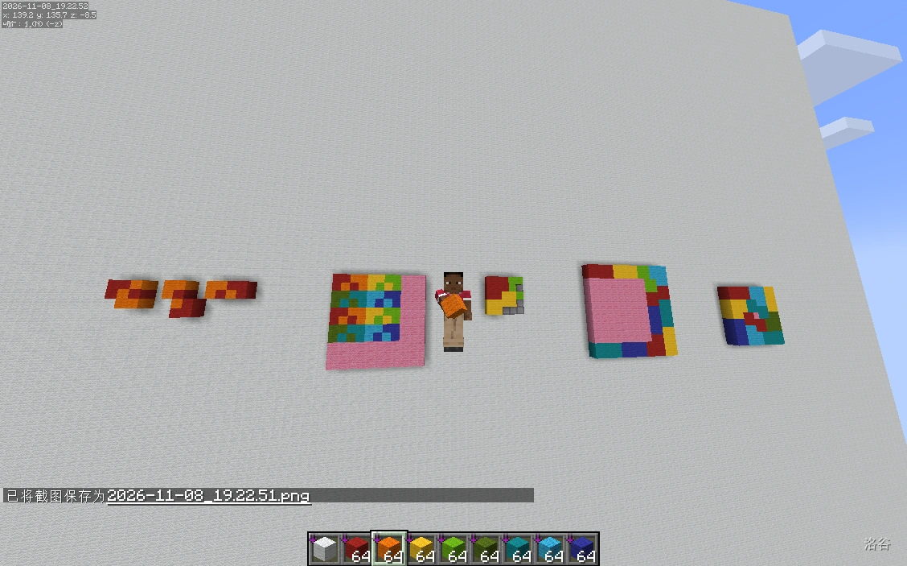

# T1

纯暴力是简单的。

由于没有对 $n$ 和 $m$ 的总和做出限制，复杂度应该只能和 $n$ 相关。考虑喷泉的上下两条边 $y = b$ 和 $y = d$，只能有两种情况：到达 $y=b$ 的时候 $x \ge c$ 或离开 $y=d$ 的时候 $x \le a$，也就是从两个方向绕过矩形。

因此可以对两种情况分别枚举，对于第一种情况，考虑枚举其离开 $y = b$ 的位置，在之前和之后的路径上都可以任选，但是对于这个位置，下一步必须要求向上，否则就会算重。对于第二种情况类似。这样两部分都是一个组合数，直接乘起来求和即可。

# T2
好像有一些简单的做法，但是场上想到了一个比较好想的。

感觉图的性质未必好分析（事实上貌似是有的），于是尝试优化建图。异或和的限制并不是一个区间，所以线段树不合适，考虑 01-Trie，相当于对于每个 $a_i$ 连向 01-Trie 上的一些位置。从高位到低位考虑，对于最高位而言，如果 $m$ 的这一位是 $1$ 而 $a_i$ 和 $a_j$ 在这一位相同，那么这一对数是肯定合法的。因此，$a_i$ 可以连向最高位和他相同的子树的所有点，而相反的点这一位的异或和是 $1$，因此还需要继续考虑后面的位，所以向这一侧继续递归。而如果 $m$ 的这一位是 $0$，则两个数的这一位不同的时候就炸了，只有相同的时候才可能可行，因此向相同侧递归。

这样的话，节点数量是 $O(n \log V)$ 的，最终只需要跑一遍 Dijkstra，总复杂度是 $O(n \log V \log n)$。

# T3
$A,S,E$ 都是占位的，并没有提供什么别的限制，可以先不管。不妨设三个 $T$ 为 $T_1,T_2,T_3$，两个 $O$ 为 $O_1,O_2$。

发现由于 $T$ 是前缀 $O$ 是后缀，只要 $|T|$ 和 $|O|$ 确定了，那么 $T$ 和 $O$ 的具体内容也就确定了，所以只需要考虑长度。这样直接枚举的话，只需要考虑 $T_2$ 在哪，这个是容易算的，可以做到 $O(n^3)$。

然后考虑优化。发现末尾如果满足 $O_1+T_3+O_2$ 的结构，那么将 $T_3$ 继续向后扩展一定还是一个合法的结构。因此，考虑对于每个起点，它要想成为 $T_3$，需要使得前后的 $O$ 是相同的（这规定了长度的下界），并且和等长的前缀是相同的（这规定了一个上界）。因此，每个位置能够成为 $T_3$ 的长度是一段区间。

同时，随着 $T$ 的延长，$T_2$ 会在后向延长，而 $O_1$ 会在前向缩短，因此 $T_2$ 到 $O_1$ 之间的空隙是始终不变的。下图可以辅助理解：

这意味着，对于某一种选择 $T$ 的方式，其贡献总是相同的，即划分 $S+E$ 的方案数。

因此考虑从小到大枚举 $T$ 的长度，在这个过程中，一部分起点可以作为 $T_2$，一部分可以同时作为 $T_2$ 和 $T_3$。考虑从小到大扫的过程中，动态计算当前长度的所有方案，在每个串可以变成 $T_3$ 和不再可以成为 $T$ 的时候更新，全部累加起来就是答案。

# T4
首先样例已经给出了 $4$ 的构造。手玩一下应该能玩到 $10$ 就是复杂一些罢了。

发现 $n=4k$ 可以用 $4$ 的构造拼起来。同时样例里面给的是 $4 \times 4$ 的方块，实际上容易发现可以是 $2 \times 4$ 拼在一起。构造方案就是把两个下方的块卡在一起。这样就容易得到 $4k+2$ 的情况，首先把内部的 $4k$ 的正方形正常摆放，然后在两侧拼 $2 \times 4$ 的小条即可。

这里最底下的四个位置是永远无法填满的，证明是考虑对整个棋盘黑白染色：

一个模块一定占了 $3$ 个黑色和 $1$ 个白色（或者反过来），而要想全部放满需要 $\frac{(4k+2)^2}4=(2k+1)^2$ 是奇数，因此一定占了奇数个黑色和白色块，这不可能。

因此偶数情况已经解决，现在需要考虑奇数。这个看上去不大好做，因此首先把模块拼成三个更好看的积木：

那么 $n=4k+3$ 的情况可以和 $4k+2$ 类似考虑，尝试在外侧包裹以转化问题：

这样 $4k+3$ 就变成 $4k+1$ 的情况了，现在只需要处理 $4k+1$ 的情况了。

当 $n=1$ 时答案为 $0$。

当 $n=5$ 的时候可以写个爆搜，或者手摸一下容易发现答案不超过 $5$，要空 $5$ 格。

算了懒得画了，用 Wei_Han 的图了（

然后对于 $n=9$，可以得到下面的构造，显然得到最优解：

对于大于 $9$ 的情况，可以用如下方式扩展：

这样就解决了所有的情况！

