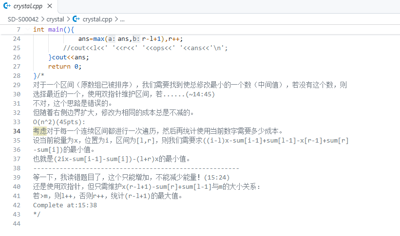
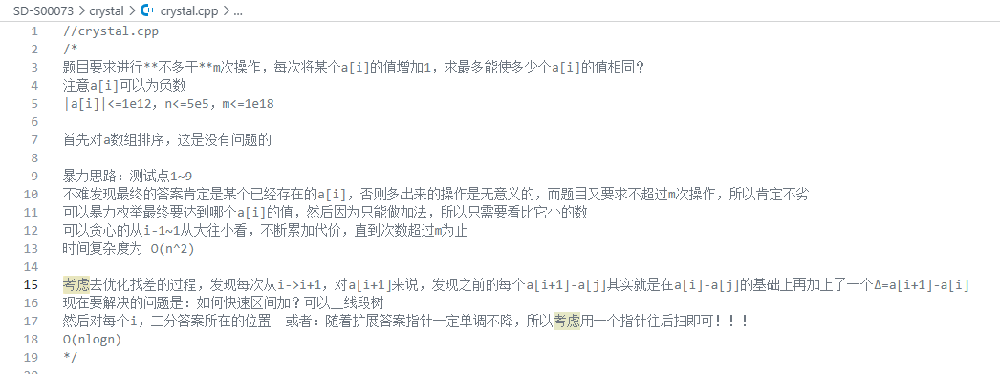
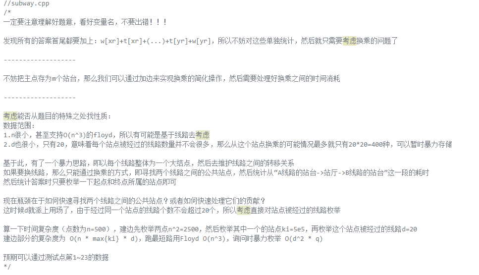
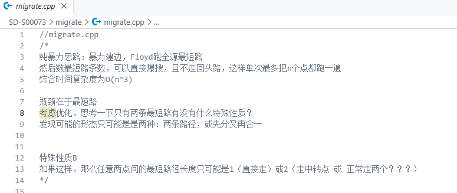
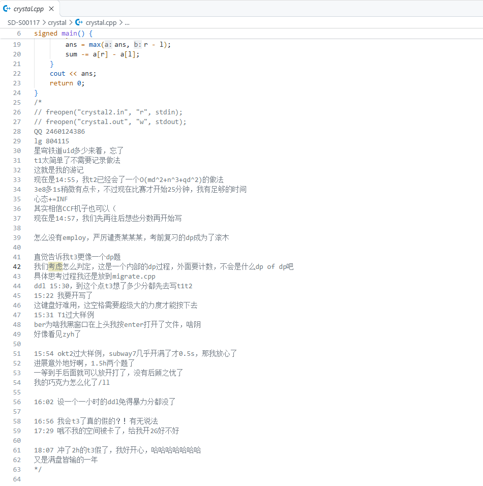
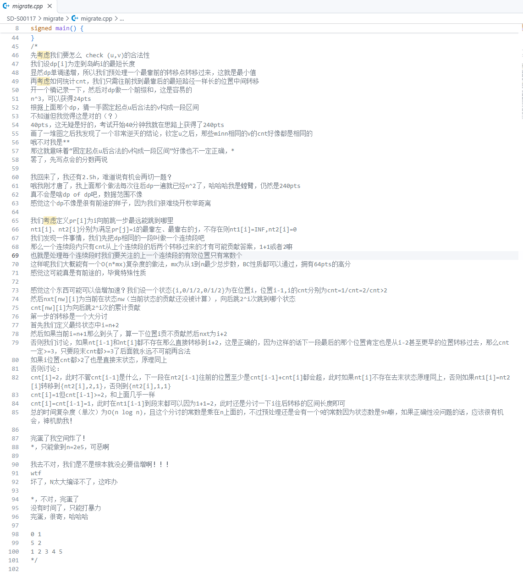
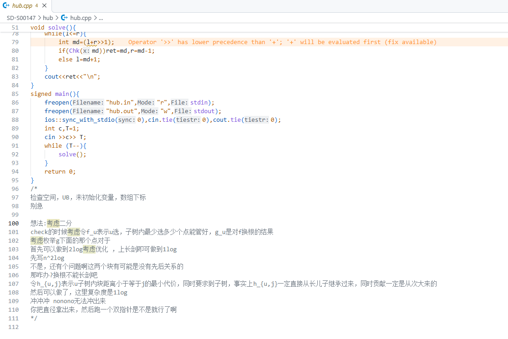
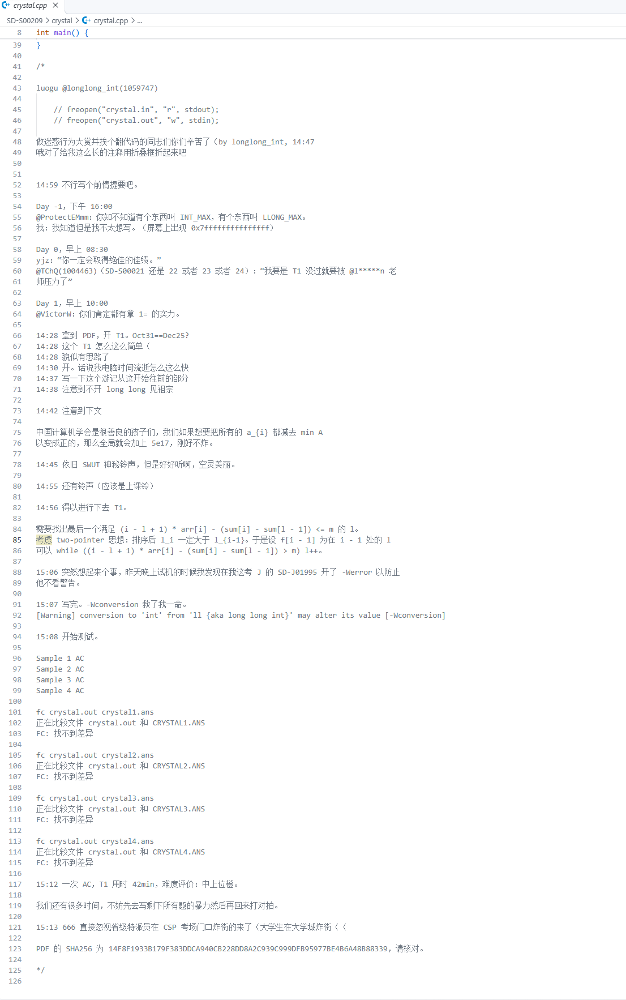
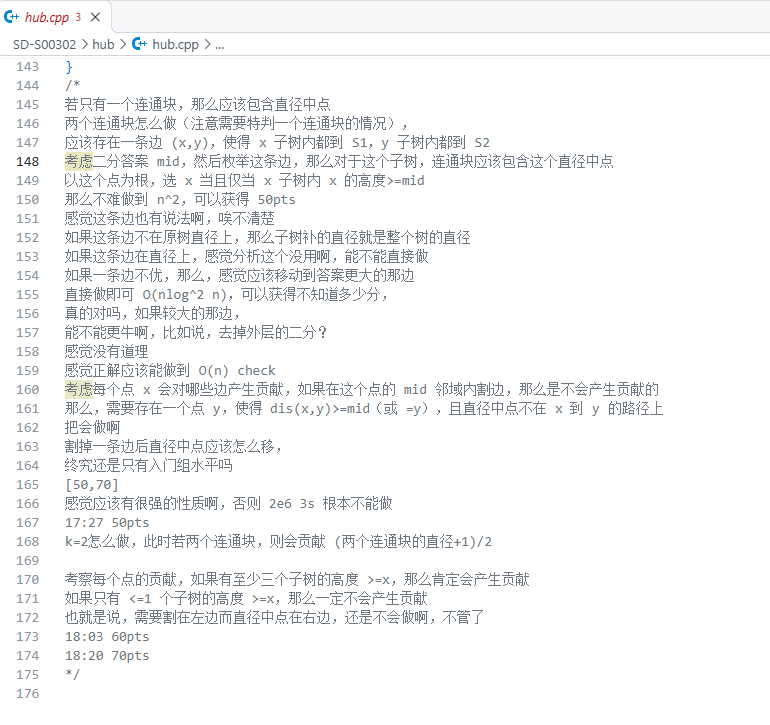

结论先说：
- `CCF` 在 49 文件中有 16112 个结果，其中 SD-S00187/hub/hub.cpp 贡献了 6053 个，SD-S01701/crystal/crystal.cpp 贡献了 10000 个
- `fuck` 在 7 文件中有 10 个结果
- `GPT` 在 1 文件中有 1 个结果
- `//freopen` 在 110 文件中有 209 个结果
- `crystal[1-4].in` 在 20 文件中有 28 个结果
- `subway[1-7].in` 在 21 文件中有 27 个结果
- `migrate[1-6].in` 在 27 文件中有 33 个结果
- `crysatl` 在 1 文件中有 1 个结果
- `crytal` 在 1 文件中有 2 个结果
- `subwy` 在 1 文件中有 2 个结果
- `migreat` 在 1 文件中有 1 个结果
- `p***hub`（`*` 是原始字符） 在 1 文件中有 1 个结果
- `recall` 在 9 文件中有 104 个结果
- `追忆` 在 11 文件中有 13 个结果
- `原神` 在 4 文件中有 4 个结果
- `日照` 在 2 文件中有 2 个结果
- `md^2` 在 11 文件中有 12 个结果
- 没有找到 `.cpp.cpp` 文件

# \<think\>
提示：这一段相对无聊。
## SD-S00042
- crystal.cpp

## SD-S00073
- crystal.cpp

- subway.cpp

咦，这不是正解吗。

- migrate.cpp

等会，为什么可以是两条路径来着？

## SD-S00117
- crystal.cpp

再次提醒，你的复杂度算的是错的，这会被 CCF 检查。

- migrate.cpp

不过好像你猜的第一个结论就错了……

## SD-S00142
- subway.cpp

## SD-S00147
- hub.cpp

很遗憾，根据本地测试结果，这份代码只获得了 $5$ 分。

## SD-S00209
- crystal.cpp

-Wconversion 是个好东西，可惜我的同学并没有注意到 `m` 的范围，于是挂到了 $60$。

## SD-S00302
- hub.cpp

OldDriverTree nb。

## 